  
  
  
  

### About

I build fast, well-tested web applications end to end, and the frontend is where I obsess: pixel-precise layouts, fluid motion and interactions that make a product feel premium. **6+ years** shipping production systems across fintech, e-commerce, media, and government, currently as a technical lead.

- 🎨 **UI & motion first**: every project I ship gets considered transitions, micro-interactions and polish down to the last pixel
- 🔭 Building full-stack products with **Next.js, TypeScript & Node.js**
- 🧪 Treat tests as part of the feature: unit, integration and end-to-end before it ships
- 🧑‍🏫 Running **LaunchPad IT Bootcamp**, teaching the MERN stack to a cohort in Abuja
- ⚽ Real Madrid supporter. Football is life.
- 💬 Ask me about **animation, React, Next.js, Node.js** or anything full-stack

### UI & motion

<table>
  <tr>
    <td width="33%" valign="top">
      <b>✨ Micro-interactions</b> 
      Hover, press, toggle and loading states that give every control feedback and personality.
    </td>
    <td width="33%" valign="top">
      <b>🎬 Page & scroll motion</b> 
      Route transitions, staggered reveals and scroll-driven storytelling that stay smooth at 60fps.
    </td>
    <td width="33%" valign="top">
      <b>📐 Pixel-precise UI</b> 
      Design-faithful builds from Figma, responsive down to the smallest screen, with no layout shift.
    </td>
  </tr>
  <tr>
    <td valign="top">
      <b>⚡ Performance-aware</b> 
      GPU-friendly transforms, lazy-loaded media and animation that never blocks the main thread.
    </td>
    <td valign="top">
      <b>♿ Accessible motion</b> 
      Respects <code>prefers-reduced-motion</code>, keeps focus states visible and content readable.
    </td>
    <td valign="top">
      <b>🧩 Design systems</b> 
      Reusable, themeable components with motion tokens so the whole product moves consistently.
    </td>
  </tr>
</table>

The banner at the top is hand-built SVG + CSS animation, no GIFs.

### Stack

<table>
  <tr>
    <td width="130"><b>Frontend</b></td>
    <td></td>
  </tr>
  <tr>
    <td><b>UI & motion</b></td>
    <td>
      
      
      
      
      
    </td>
  </tr>
  <tr>
    <td><b>Backend & data</b></td>
    <td></td>
  </tr>
  <tr>
    <td><b>CMS & tooling</b></td>
    <td> </td>
  </tr>
  <tr>
    <td><b>Testing & quality</b></td>
    <td>
      
      
      
      
      
      
      
      
    </td>
  </tr>
</table>

### Featured work

<table>
  <tr>
    <td width="50%" valign="top">
      <a href="https://www.levah.co/"><b>Levah</b></a> 
      Retail e-commerce management platform  
      <code>Next.js · TypeScript · Node.js</code> 
      <a href="https://www.levah.co/">levah.co ↗</a>
    </td>
    <td width="50%" valign="top">
      <a href="https://nep.rea.gov.ng/"><b>NEP · Rural Electrification Agency</b></a> 
      National Electrification Project platform  
      <code>Next.js · TypeScript · Tailwind</code> 
      <a href="https://nep.rea.gov.ng/">nep.rea.gov.ng ↗</a>
    </td>
  </tr>
  <tr>
    <td width="50%" valign="top">
      <a href="https://www.peerguardloans.com/"><b>PeerGuard Loans</b></a> 
      Fintech lending platform  
      <code>Next.js · Node.js · Tailwind</code> 
      <a href="https://www.peerguardloans.com/">peerguardloans.com ↗</a>
    </td>
    <td width="50%" valign="top">
      <a href="https://elearning.carbon-enablement.com/"><b>Nigerian Carbon Market Academy</b></a> 
      E-learning platform  
      <code>Next.js · TypeScript</code> 
      <a href="https://elearning.carbon-enablement.com/">elearning.carbon-enablement.com ↗</a>
    </td>
  </tr>
  <tr>
    <td width="50%" valign="top">
      <a href="https://redefinition.vercel.app/"><b>Redefinition Network</b></a> 
      Leadership community platform  
      <code>Next.js · Firebase · Tailwind</code> 
      <a href="https://redefinition.vercel.app/">redefinition.vercel.app ↗</a>
    </td>
    <td width="50%" valign="top">
      <a href="https://www.excitetrade.com/"><b>Excite Trade</b></a> 
      Trading platform  
      <code>React · Node.js</code> 
      <a href="https://www.excitetrade.com/">excitetrade.com ↗</a>
    </td>
  </tr>
  <tr>
    <td width="50%" valign="top">
      <a href="https://www.mojec.com/"><b>Mojec</b></a> 
      Corporate site on a headless CMS  
      <code>React · Sanity</code> 
      <a href="https://www.mojec.com/">mojec.com ↗</a>
    </td>
    <td width="50%" valign="top">
      <a href="https://steazforteltd.co.uk/"><b>Steazforte Limited</b></a> 
      Company website  
      <code>WordPress</code> 
      <a href="https://steazforteltd.co.uk/">steazforteltd.co.uk ↗</a>
    </td>
  </tr>
</table>

Full portfolio → <a href="https://theedikanbassey.com">theedikanbassey.com</a>

### Activity

  
   
  

### Languages & contribution history

Across my own, company and organization repositories (PeerGuard-Procurenet, Levah-ops and more). Refreshed daily.

  

### Achievements & organizations

  

**Open to freelance work and collaborations** — [let's talk](mailto:edikan.i.bassey@gmail.com).

